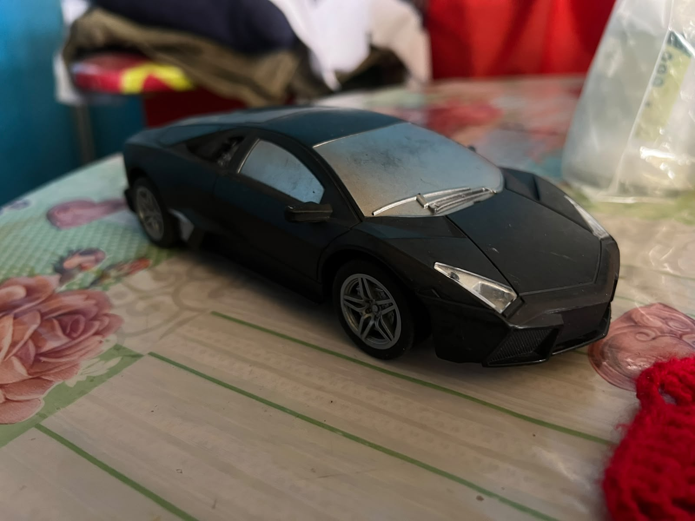
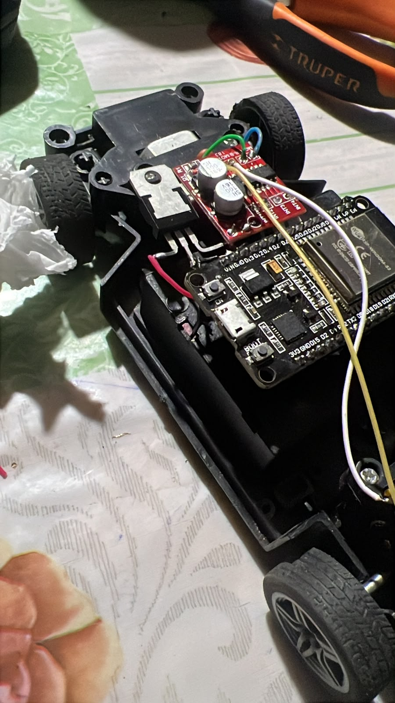
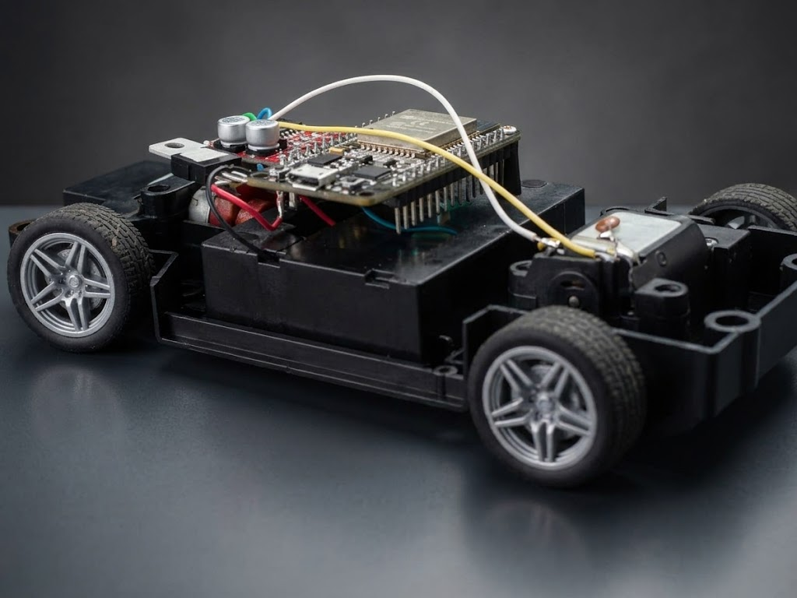
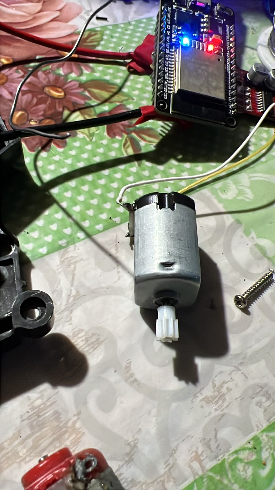
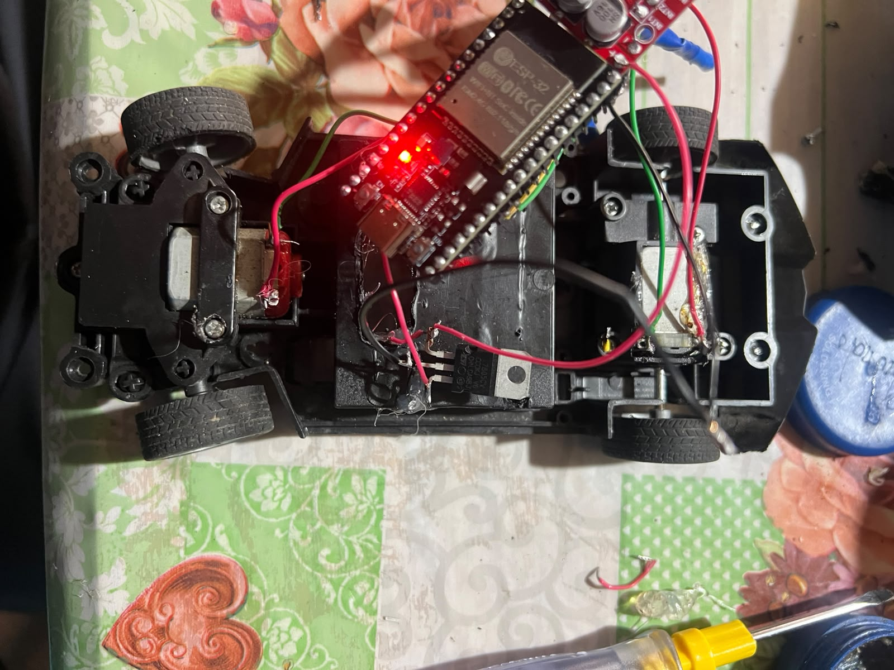
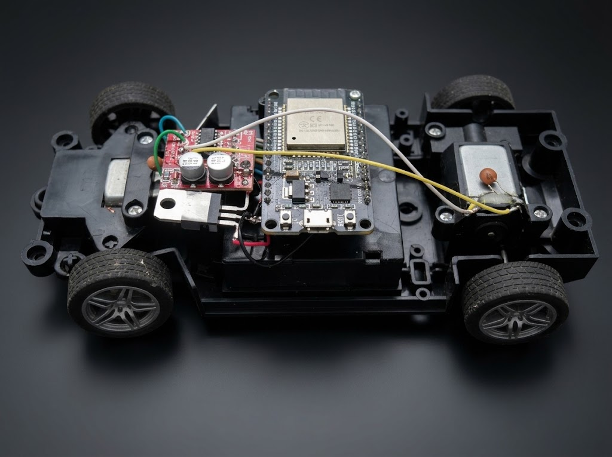

# 🏎️ 📶 Lamborghini ESP32 - Robot Móvil Inalámbrico 🤖⚡

Repositorio oficial e ingeniería del **Lamborghini ESP32**, un vehículo robótico móvil de altas prestaciones estéticas y funcionales. Este sistema implementa un servidor web embebido directamente en la memoria flash de un microcontrolador **ESP32**, generando un punto de acceso Wi-Fi autónomo para el pilotaje en tiempo real mediante un joystick táctil desde cualquier smartphone o tablet.

---

## 🌟 **Contexto y Propósito del Proyecto**

El desarrollo de este robot combina el diseño automotriz a escala (carrocería deportiva tipo Lamborghini) con la electrónica de control embebido. El sistema está diseñado para operar de forma totalmente inalámbrica mediante una red local M2M (Machine-to-Machine), eliminando la dependencia de enrutadores externos y garantizando una respuesta de control inmediata, fluida y sin latencia perceptible.

---

## 📸 **Galería del Proceso y Ensamblaje**

### 🏎️ Vista Exterior y Carrocería Finalizada
| Carrocería Estilo Lamborghini (Montada) | Vista de Perfil General |
| :---: | :---: |
| [cite: 12] | [cite: 12] |

### 🔍 Detalles del Chasis y Componentes
| Vista Lateral Ampliada del Sistema | Motor DC de Tracción (3V - 6V) |
| :---: | :---: |
| [cite: 12] | [cite: 12] |

### 🛠️ Cableado y Perspectiva Superior (Cenital)
| Proceso de Conexión y Electrónica | Vista Superior (Sky View del Chasis) |
| :---: | :---: |
| [cite: 12] | [cite: 12] |

---

## ✨ **Características Técnicas Principales**

- **Servidor Web Embebido (PROGMEM):** La interfaz gráfica de control se almacena íntegramente en el microcontrolador, optimizando recursos sin requerir tarjetas SD externas.
- **Protección Táctil Multiplataforma:** Reglas de estilo estrictas (`user-select: none;`, `-webkit-touch-callout: none;`) para evitar selecciones de texto accidentales en pantallas táctiles móviles.
- **Control PWM de Motores:** Regulación de velocidad y maniobras de giro diferencial mediante el puente H L298N Mini / MX1508.
- **Autonomía y Regulación Energética:** Sistema estabilizado mediante regulador de voltaje L7805CV para proteger la lógica del ESP32 ante fluctuaciones de la fuente de alimentación.

---

## 📋 **Lista de Materiales y Componentes**

| Categoría | Componente / Elemento | Descripción Técnica |
| :--- | :--- | :--- |
| **Procesamiento** | Placa ESP32 DevKit V1 | Microcontrolador con Wi-Fi y Bluetooth integrado (30/38 pines). |
| **Control de Motores** | Driver L298N Mini (MX1508) | Puente H doble canal para control de dirección y potencia. |
| **Actuadores** | **Motores DC (3V - 6V)** | Motorreductores compactos de tracción trasera para alta torsión. |
| **Alimentación** | Batería 9V / Li-ion 18650 | Fuente de energía autónoma para los motores y el sistema. |
| **Regulación** | Regulador L7805CV | Estabilizador de voltaje a 5V para la placa de control. |
| **Estructura** | Chasis Lamborghini Scale | Carrocería deportiva aerodinámica adaptada para robótica. |

---

## 📊 **Diagramas y Documentación Técnica**

El esquema de conexiones eléctricas y la distribución de pines se encuentran detallados en el plano oficial del proyecto:
- 📄 [Descargar / Ver Diagrama de Conexiones del Carro Móvil (PDF)](hardware/diagrama_carro_movil.pdf)[cite: 12]

---

## 🔌 **Esquema de Conexiones (Pinout del ESP32)**

| Pin GPIO ESP32 | Conexión de Hardware | Función Principal |
| :---: | :--- | :--- |
| **GPIO 16** | Driver IN1 | Control de dirección Motor Izquierdo (Adelante) |
| **GPIO 17** | Driver IN2 | Control de dirección Motor Izquierdo (Atrás) |
| **GPIO 18** | Driver IN3 | Control de dirección Motor Derecho (Adelante) |
| **GPIO 19** | Driver IN4 | Control de dirección Motor Derecho (Atrás) |
| **GPIO 2** | LED Azul Interno | Indicador visual de estado de conexión y red Wi-Fi |

---

## 🚀 **Guía de Instalación y Uso**

1. **Clonación o Descarga:** Obtén el contenido de este repositorio en tu equipo de trabajo.
2. **Carga de Firmware:** Abre el archivo de código fuente ubicado en la carpeta `src/` utilizando el **Arduino IDE** y súbelo al ESP32 (Configurar velocidad del monitor serie a `115200` baudios).
3. **Punto de Acceso Wi-Fi:** Enciende el robot mediante el interruptor general. El ESP32 generará una red inalámbrica propia de acceso directo.
4. **Pilotaje Web:** Conecta tu dispositivo móvil a la red del robot, abre tu navegador web e ingresa a la dirección IP asignada (por ejemplo, `192.168.4.1` o la IP configurada en el servidor) para interactuar con el control táctil.

---

 

### Desarrollado por Samuel Elí Villanueva Chávez
**Tecnología, Informática y Telecomunicaciones (UNDAC)**

